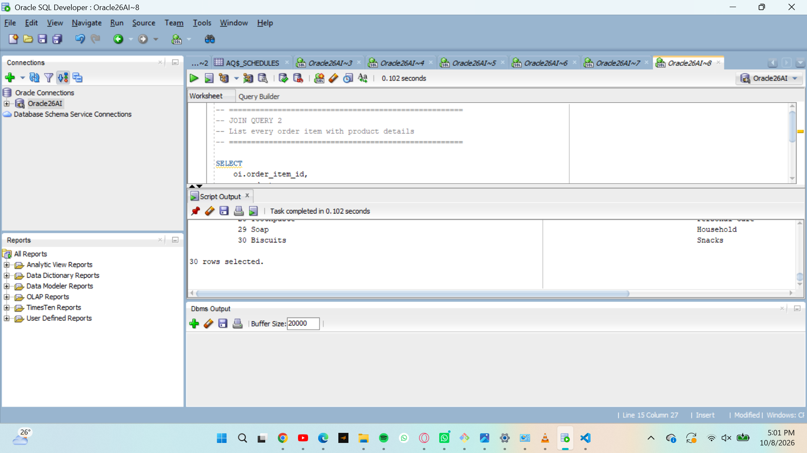
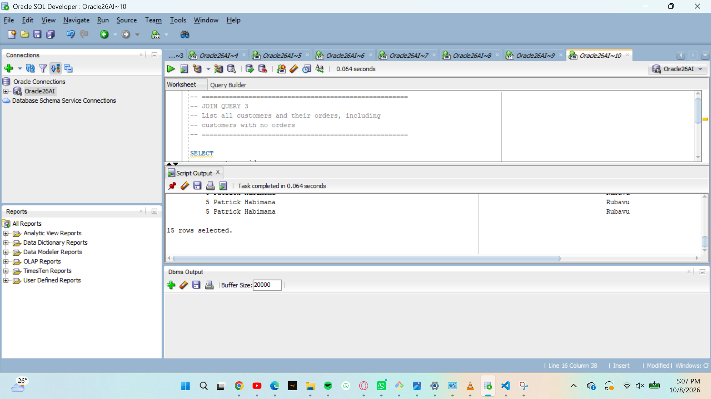
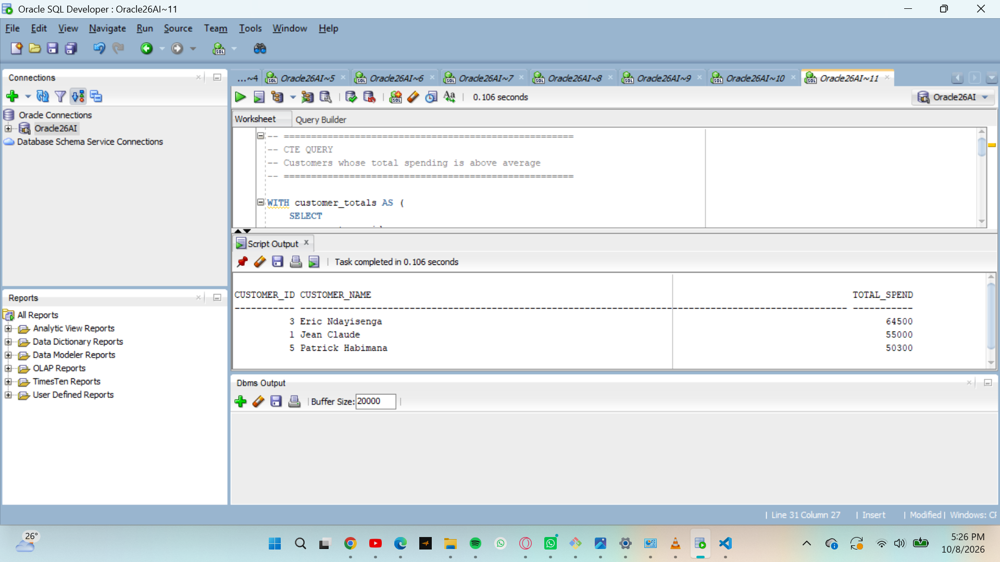
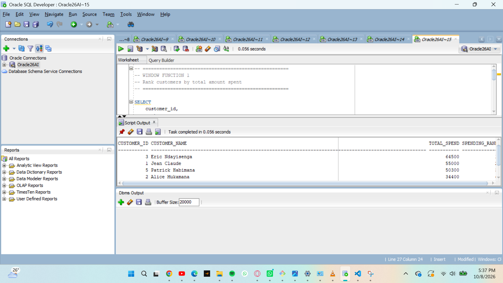
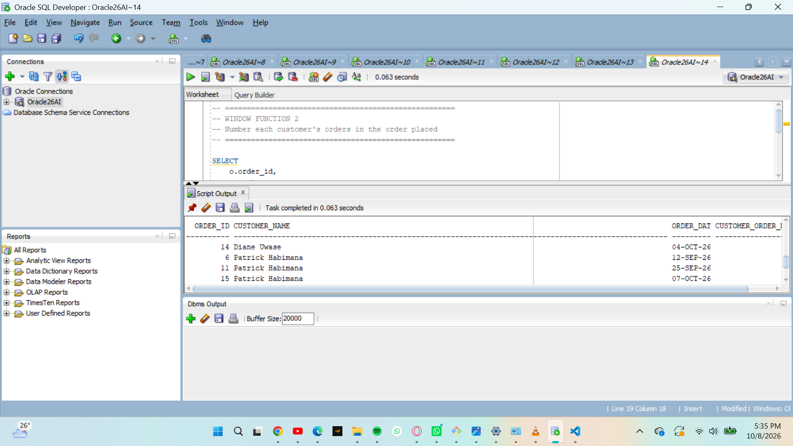
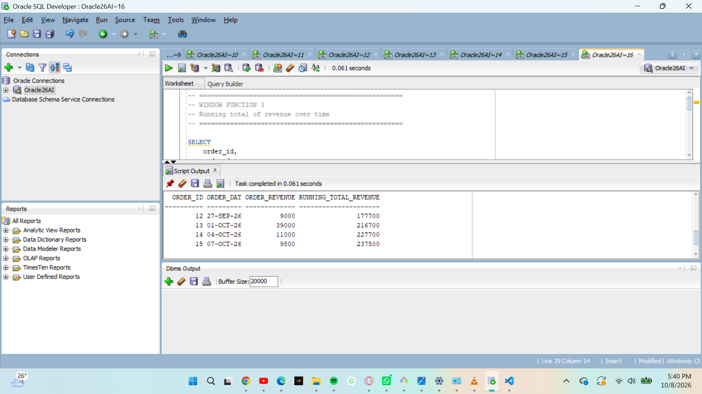
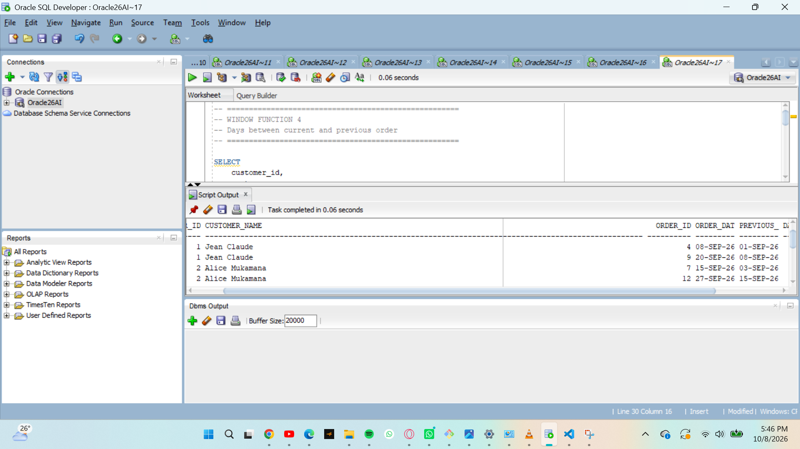

 Sunrise Supermarket SQL Analysis

Names:    TURINIMANA EMMANUEL
Student:  ID 28206
DBMS:     Oracle Database

 Sunrise Supermarket SQL Analysis
  
  1. Business Scenario

Sunrise Supermarket sells products to customers who place orders containing one or more items. Management wants to analyze customer purchases, product sales, spending, and sales trends to support better business decisions.

  2. Database Overview

The database contains four tables:

Customers    -customer details
Products     - product names, categories, and prices
Orders       -customer orders and dates
Order_Items  -products and quantities in each order

The database contains **5 customers, 8 products, 15 orders, and 30 order items** across multiple dates and product categories.

3. SQL Analysis

 JOIN Queries

1. Orders with Customer Information**
Uses an `INNER JOIN` between `orders` and `customers` to display the customer name, city, and order date.

2. Order Items with Product Information**
Uses an `INNER JOIN` between `order_items` and `products` to display product name, category, price, and quantity.

3. Customers and Their Orders**
Uses a `LEFT JOIN` to display all customers, including customers who have no orders.

Common Table Expression (CTE)

The CTE calculates each customer's total spending using:

`quantity and price`

It then identifies customers whose spending is above the average customer spending.

 Window Functions

Four window-function analyses were performed:

1. Customer Spending Rank   - ranks customers by total spending.
2. Order Numbering          - numbers each customer's orders chronologically.
3. Running Revenue          - calculates cumulative revenue over time.
4. Days Between Orders      -uses `LAG()` to calculate the number of days between a customer's purchases.

 4. Business Interpretation

The analysis helps Sunrise Supermarket:

* Identify high-value customers.
* Understand customer purchasing frequency.
* Monitor revenue growth over time.
* Analyze product purchasing activity.
* Support customer retention and promotional decisions.

 5. Challenges and Solutions

 Challenge: Combining information from multiple related tables.

 Solution: Used primary and foreign keys with appropriate JOINs.

Challenge: Performing advanced customer and time-based analysis.
Solution: Used CTEs and window functions such as `RANK()`, `ROW_NUMBER()`, `SUM() OVER`, and `LAG()`.

 6. How to Run

1. Open  "Oracle SQL Developer".
2. Connect to the Oracle database.
3. Open `sql/solutions.sql`.
4. Run the SQL statements to create/populate the database and perform the analysis.
5. View the query results in SQL Developer.

> Note: Do not rerun INSERT statements on an already populated database because duplicate primary-key errors may occur.

 7. Project Structure

assignment_1_turinimana-emmanuel-28206/

   README.md
   sql/
   solutions.sql
   screenshots/
       (JOIN Query 1 — Orders and Customers()

JOIN Query 2 — Order Items and Products()

JOIN Query 3 — All Customers and Orders()

CTE — Customer Spending()

Window Function 1 — Customer Ranking()

Window Function 2 — Order Numbering

Window Function 3 — Running Revenue()

Window Function 4 — Days Between Orders()

8. Conclusion

This project demonstrates how SQL JOINs, CTEs, and Window Functions can be used to transform supermarket data into useful business information for decision-making.
